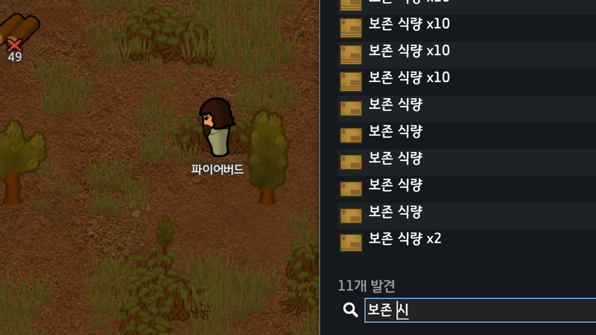

# Rimworld-KRInput

**Deprecated — RimWorld 1.7.4980 rev60에서 게임 본체에 Windows IME 지원이 추가되었습니다.**

해당 버전에서는 이 모드를 비활성화하거나 제거하세요. 현재 빌드는 본체와의 중복 처리를 피하기 위해 IME 패치를 설치하지 않습니다.



림월드 1.7 unstable 브랜치에서 한글 IME와 림월드와 잘 맞지 않는 현상을 수정하는 모드입니다.

자세한 작동 원리는 [IMPLEMENT](./docs/agent/IMPLEMENT.md) 문서를 참조해주세요.

## 빌드

`.NET 10 SDK`와 RimWorld 1.7 설치본이 필요합니다. 기본 경로가 다르면 `RIMWORLD_DIR` 또는 `-p:RimWorldDir="게임 루트"`를 지정합니다.

RimWorld 1.7.4980 rev60의 GUI API를 기준으로 빌드합니다. 현재 빌드는 IME 패치가 비활성화되어 있습니다.

```powershell
dotnet build package.csproj
```

로 하면 빌드가 되면서 업데이트가 됩니다.
